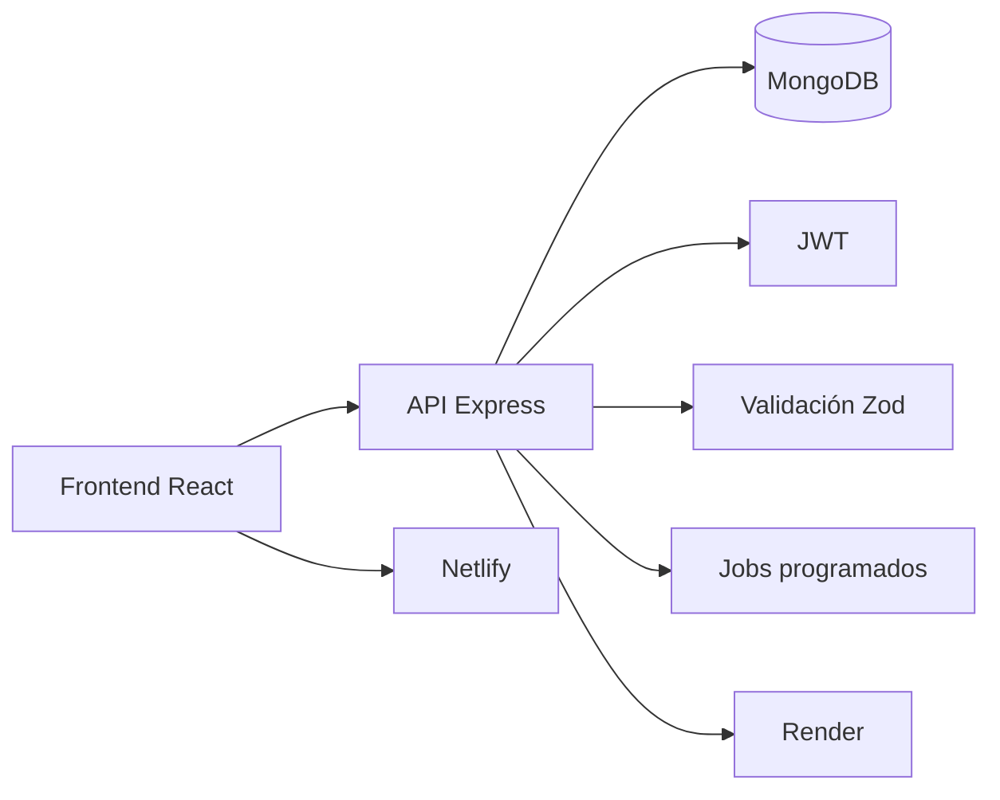

# Sweet Medical — Plataforma de Turnos Médicos


[English](README.md) | [Español](README.es.md)

> Trabajo práctico grupal de **Desarrollo de Software**, UTN FRBA, 2026.
> Hecho con **5 compañeros**.


## Descripción

Sweet Medical es una plataforma de obra social y turnos médicos. Los pacientes pueden buscar turnos, comparar coberturas, reservar y gestionar sus visitas; los médicos pueden administrar su disponibilidad, perfil y agenda.

## Features

- Roles de paciente y médico.
- Búsqueda de turnos por especialidad, fecha y ubicación.
- Niveles de cobertura: total, parcial y no cubierta.
- Reserva, cancelación e historial de turnos.
- Perfiles de médicos, ratings y reseñas.
- Notificaciones.
- UI responsive para mobile y desktop.
- Configuración de administración y despliegue.

## Arquitectura



Monorepo con npm workspaces:

- `packages/frontend` — aplicación React.
- `packages/backend` — API Express con MongoDB, JWT, Zod, Swagger y schedulers.

## Mi rol

Trabajé en el frontend y en el despliegue:

- Vistas responsive de home y búsqueda de turnos.
- Renderizado condicional según rol (paciente/médico).
- Menú hamburguesa y layouts mobile.
- Snackbars de confirmación y UI de notificaciones.
- Dockerfiles y Docker Compose para todo el stack.
- Deploy con Render y Netlify.
- Colaboración en backend: validación Zod, modelos MongoDB e integración de API.

## Stack

`React` · `Express` · `MongoDB` · `Mongoose` · `JWT` · `Zod` · `Swagger` · `Docker` · `Render` · `Netlify` · `Jest` · `Cypress`

## Cómo levantarlo

```bash
npm install
cp packages/backend/.env.example packages/backend/.env
npm run start:dev
```

Variables principales en `packages/backend/.env`:

| Variable | Uso |
|---|---|
| `MONGODB_URI` | Conexión a MongoDB |
| `MONGODB_DB_NAME` | Nombre de la base |
| `JWT_SECRET` | Firma de tokens |
| `JWT_EXPIRATION` | Duración del token |
| `SERVER_PORT` | Puerto de la API |
| `ALLOWED_ORIGINS` | Orígenes CORS |

## Estructura

```text
├── packages/
│   ├── backend/     # API Express, dominio, repositorios y rutas
│   └── frontend/    # App React, features, componentes y clientes API
├── package.json
└── packages/docker-compose.yml
```

## Notas

- Código publicado con fines de portfolio.
- No hay credenciales en el repo; usar `.env.example`.
- Proyecto académico grupal.
