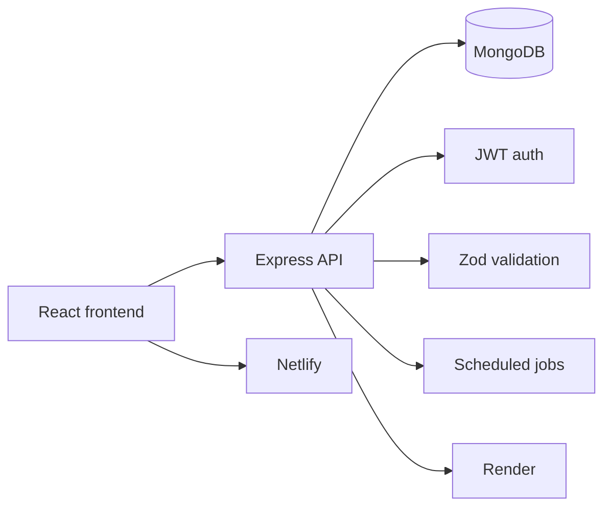

# Sweet Medical — Medical Appointment Platform

> Group project for **Desarrollo de Software**, UTN FRBA, 2026.
> The repository is private. This case study documents the product, architecture and my contribution.

## Overview

Sweet Medical is a health insurance and appointment platform. Patients can search for appointments, compare coverage, book and manage their visits; doctors can manage their availability and profile.

## Features

- Patient and doctor roles.
- Appointment search with specialty, date and location filters.
- Coverage levels: total, partial and not covered.
- Appointment booking and cancellation.
- Doctor profiles, ratings and reviews.
- Notifications.
- Responsive layouts for mobile and desktop.
- Admin and deployment configuration.

## Architecture

The project is a monorepo managed with npm workspaces:

- `packages/frontend` — React application.
- `packages/backend` — Express API with MongoDB, JWT, Zod, Swagger and schedulers.

## My role

I worked across the frontend and the deployment:

- Responsive home and appointment-search views.
- Role-based rendering for patients and doctors.
- Hamburger navigation and mobile layouts.
- Confirmation snackbars and notification UI.
- Dockerfiles and Docker Compose for the full stack.
- Deployment with Render and Netlify.
- Backend collaboration: Zod validation, MongoDB models and API integration.

## Stack

`React` · `Express` · `MongoDB` · `Mongoose` · `JWT` · `Zod` · `Swagger` · `Docker` · `Render` · `Netlify`

## Links

- [LinkedIn](https://www.linkedin.com/in/luca-domio-dev)
- [Portfolio](https://github.com/lDomio)
- Code available on request.
