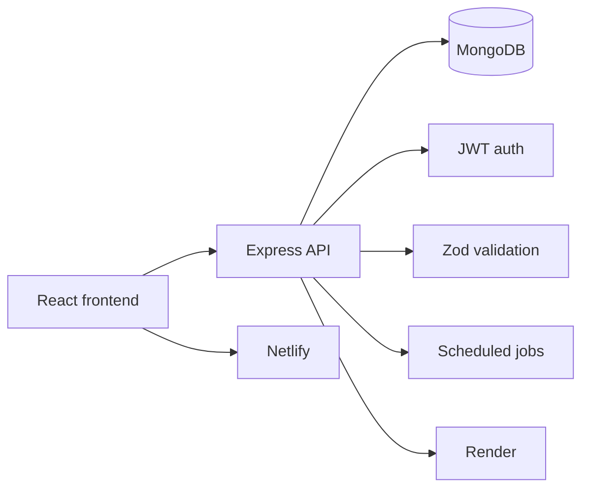

# Sweet Medical — Medical Appointment Platform


[English](README.md) | [Español](README.es.md)

> Group project for **Desarrollo de Software**, UTN FRBA, 2026.
> Built with **5 colleagues**.


## Overview

Sweet Medical is a health insurance and appointment platform. Patients can search for appointments, compare coverage, book and manage visits; doctors can manage availability, profiles and appointments.

## Features

- Patient and doctor roles.
- Appointment search by specialty, date and location.
- Coverage levels: total, partial and not covered.
- Booking, cancellation and appointment history.
- Doctor profiles, ratings and reviews.
- Notifications.
- Responsive UI for mobile and desktop.
- Admin and deployment configuration.

## Architecture



Monorepo with npm workspaces:

- `packages/frontend` — React application.
- `packages/backend` — Express API with MongoDB, JWT, Zod, Swagger and schedulers.

## My role

I worked across the frontend and deployment:

- Responsive home and appointment-search views.
- Role-based rendering for patients and doctors.
- Hamburger navigation and mobile layouts.
- Confirmation snackbars and notification UI.
- Dockerfiles and Docker Compose for the full stack.
- Deployment with Render and Netlify.
- Backend collaboration: Zod validation, MongoDB models and API integration.

## Stack

`React` · `Express` · `MongoDB` · `Mongoose` · `JWT` · `Zod` · `Swagger` · `Docker` · `Render` · `Netlify` · `Jest` · `Cypress`

## Running locally

```bash
npm install
cp packages/backend/.env.example packages/backend/.env
npm run start:dev
```

Set the required environment variables in `packages/backend/.env`:

| Variable | Purpose |
|---|---|
| `MONGODB_URI` | MongoDB connection string |
| `MONGODB_DB_NAME` | Database name |
| `JWT_SECRET` | JWT signing secret |
| `JWT_EXPIRATION` | Token lifetime |
| `SERVER_PORT` | API port |
| `ALLOWED_ORIGINS` | CORS origins |

## Structure

```text
├── packages/
│   ├── backend/     # Express API, domain, repositories, routes
│   └── frontend/    # React app, features, components, API clients
├── package.json
└── packages/docker-compose.yml
```

## Notes

- Code published for portfolio purposes.
- No credentials are committed; use `.env.example`.
- Academic team project.
